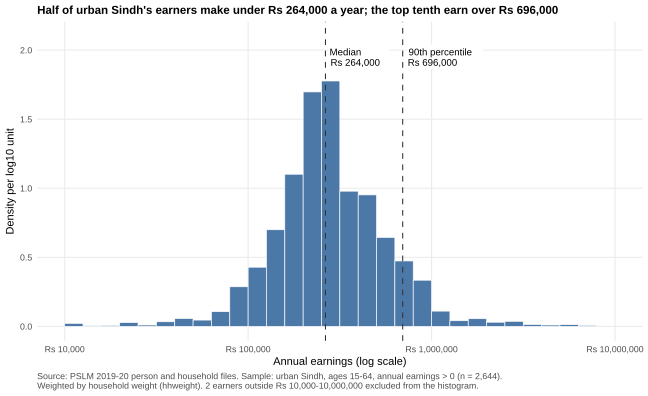
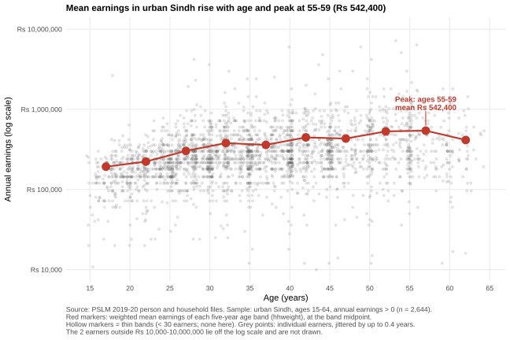
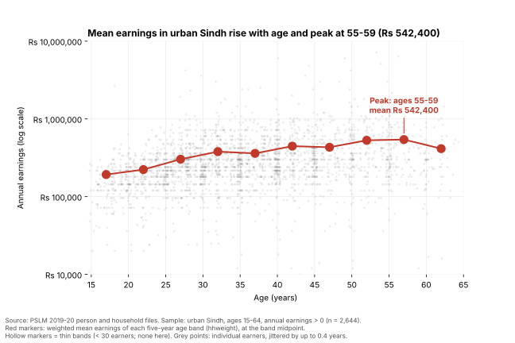

# ECO346 Assignment 1 — FA24-BEDS-051

**Variant 3: Sindh urban.** 51 = 6 × 8 + 3. Sample: persons in urban Sindh (`prov_code == 3`, `urban_rural == 2`) aged 15–64 with `earn_annual > 0`. All statistics are weighted by `hhweight`.

## How to reproduce

Run from the repository root (no internet needed; data are in `data/`):

```
Rscript scripts/01_default.R          # figures/default.svg
Rscript scripts/02_distribution.R     # figures/distribution.svg + Q2 numbers
Rscript scripts/03_relationship.R     # figures/relationship.svg + band table
python  scripts/04_second_language.py # figures/relationship_python.svg + band table
```

`scripts/00_setup.R` is shared by the R scripts: it merges the files, applies the sample, and defines the weighted quantile and mean. R packages: `dplyr`, `ggplot2`, `scales`, `svglite`. Python packages: `pandas`, `numpy`, `matplotlib`.

## Q2. The distribution



| Statistic | Value |
|---|---|
| Number of earners | 2,644 |
| Weighted median | Rs 264,000 |
| Unweighted median | Rs 252,000 |
| Weighted 10th percentile | Rs 120,000 |
| Weighted 90th percentile | Rs 696,000 |
| P90 / P10 | 5.80 |
| Excluded from histogram | 2 |

Earnings in urban Sindh are roughly log-normal, peaking at Rs 200,000–300,000. A top-tenth earner makes at least 5.8 times what a bottom-tenth earner makes, and a thin right tail reaches millions. The weighted median (Rs 264,000) exceeds the unweighted one (Rs 252,000) because households with larger weights, each standing for more people in the population, have slightly higher earnings. The gap is small, so the raw sample is not badly skewed.

## Q3. The relationship



| Band | Earners | Weighted mean earnings (Rs) |
|---|---:|---:|
| 15–19 | 160 | 192,523 |
| 20–24 | 296 | 222,948 |
| 25–29 | 398 | 303,154 |
| 30–34 | 396 | 379,254 |
| 35–39 | 359 | 360,221 |
| 40–44 | 344 | 446,533 |
| 45–49 | 250 | 431,697 |
| 50–54 | 212 | 530,773 |
| 55–59 | 157 | 542,400 |
| 60–64 | 72 | 414,262 |

25–29: **Rs 303,154**. 45–49: **Rs 431,697**. Highest band: **55–59** (Rs 542,400). No band is thin (all have at least 30 earners).

Mean earnings follow a classic age–earnings profile: they rise steeply through the twenties and thirties as workers gain experience and skills, keep rising more slowly to a peak at 55–59, then fall at 60–64 as people retire or move to lighter work. Within every band, earnings vary enormously, so age explains only part of the differences. The figure is a cross-section: it cannot tell us whether one person's earnings grow with age, because each band is a different cohort.

## Q4. The makeover

Default: [figures/default.svg](figures/default.svg). Redesign: the Q3 figure above.

The default plots raw rupees on a linear scale, so a few millionaires squash almost everyone into a flat band near zero. Putting earnings on a log scale spreads that mass out and makes proportional differences visible. The default also suffers severe overplotting: integer ages stack points into solid columns. Jittering by up to 0.4 years and using transparency (alpha 0.15) let density show as darkness. Third, the default shows no summary; adding weighted conditional means, joined by a line, encodes the age profile as position along a common scale, the most accurately perceived channel. Finally, the grey background and scientific-notation labels give way to a light theme, rupee labels, a finding-stating title and direct annotation, which raises the data–ink ratio. What the redesign hides: the default shows the extreme earners at their true distance from everyone else, and two earners below Rs 10,000 fall off the log axis entirely.

## Q5. A second language (Python)

Band tables from R (`figures/band_table_R.csv`) and Python (`figures/band_table_python.csv`) are identical, file for file. 25–29 band mean: **R Rs 303,154; Python Rs 303,154.**

matplotlib's log axis labels ticks in mathematical notation (10⁴, 10⁵…) and adds unlabelled minor ticks, whereas I labelled the R axis in rupees. I set a `FixedLocator` at each power of ten with "Rs" labels and a `NullLocator` for minor ticks. I also removed matplotlib's box border and added light gridlines to match `theme_minimal()`.


